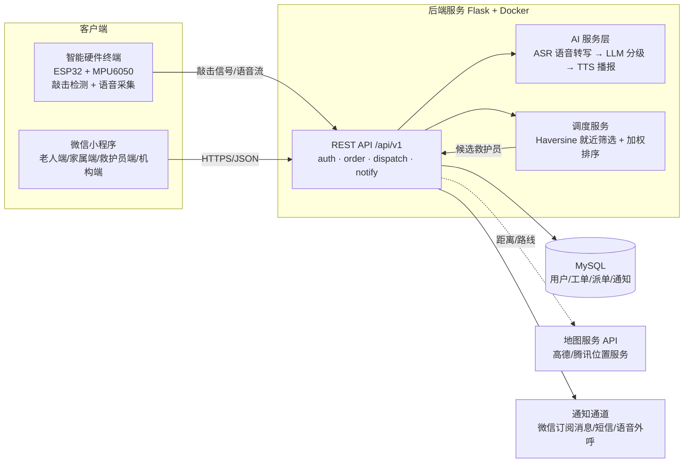
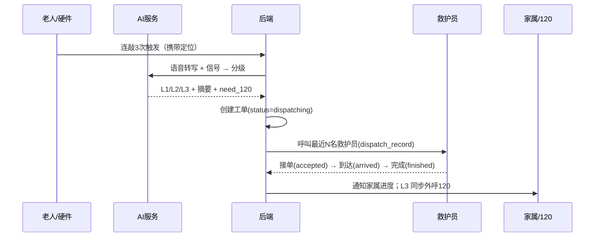

# 02 系统架构说明

## 1. 总体架构



## 2. 三端与角色

| 端 | 角色 | 核心功能 |
| --- | --- | --- |
| 小程序 | 老人（elder） | 极简界面：求助按钮状态、AI 对话、我的求助记录 |
| 小程序 | 家属（family） | 绑定老人、接收通知、查看工单进度、代为发起求助 |
| 小程序 | 救护员（rescuer） | 资质提交、上下线与位置上报、接单大厅、到达/完成 |
| 小程序 | 机构（org） | 人才库管理、工单看板（二期） |
| 硬件 | — | 连敲 3 次触发、跌倒姿态检测、语音采集与播报 |

## 3. 核心业务流程



分级策略（`ai_service.grade_emergency`）：

- **L1** 非紧急：仅需人陪护确认，通知家属；
- **L2** 紧急但暂不需 120：派就近救护员上门；
- **L3** 危重：立即通知 120 + 家属 + 就近救护员同时出发。

骨架阶段使用关键词规则实现，接口形态与真实大模型一致；接入 LLM/ASR 后仅替换该服务内部实现。

## 4. 技术选型

| 层 | 选型 | 理由 |
| --- | --- | --- |
| Web 框架 | Flask 3 | 轻量、团队熟悉、便于接口先行 |
| ORM/数据库 | Flask-SQLAlchemy + MySQL（PyMySQL） | 事务与关系建模成熟 |
| 鉴权 | itsdangerous 签名令牌（后续可平滑切 JWT） | 零额外依赖，骨架期够用 |
| 部署 | Docker + docker-compose（dev/test 双环境） | 环境一致，云服务器迁移成本低 |
| 测试 | pytest | 已覆盖 9 个核心用例 |
| AI | LLM 对话接口 + ASR/TTS | 申报书预算内的云端 API |

## 5. 代码结构

```
app/
├── __init__.py        # 应用工厂，注册蓝图与错误处理
├── extensions.py      # db 实例
├── models/            # 5 张表：user / rescuer_profile / help_order / dispatch_record / notification_log
├── api/               # 蓝图：auth / orders / dispatch / notify（前缀 /api/v1）
├── services/          # ai_service（分级）、dispatch_service（就近调度）
└── utils/             # 统一响应、令牌鉴权
tests/                 # pytest：健康检查、注册登录、建单分级、距离与候选过滤
```

## 6. 部署形态

- 开发/测试：docker-compose 起 MySQL 容器（`qiaoqiao_dev` / `qiaoqiao_test`），本机跑 Flask；
- 中期后：轻量云服务器 + Docker Compose 一键部署，域名 + HTTPS；微信小程序服务端域名备案配置。
