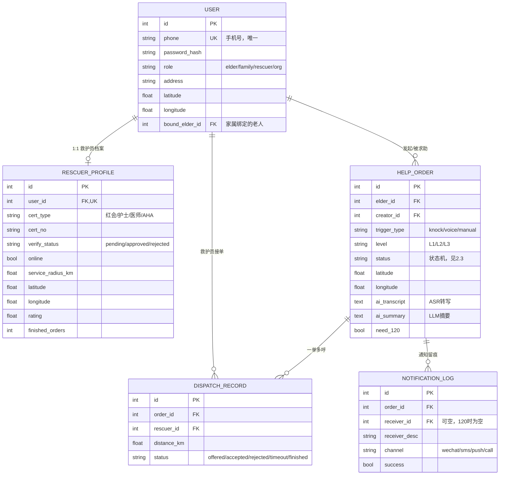

# 03 数据库设计

## 1. ER 图

考虑到后期多端互通和部分老人无微信的情况，账号体系采用了手机号+密码模式，微信端后续通过 unionid 静默绑定



## 2. 关键设计

### 2.1 单账号多角色

`user.role` 区分四类角色，家属通过 `bound_elder_id` 与老人绑定，老人端注册信息极少（手机号 + 密码即可），符合适老化要求。

### 2.2 工单的 AI 字段

`help_order` 冗余存储 `ai_transcript`（原始转写）、`ai_summary`（分级摘要）、`need_120`，救护员接单前可直接看到摘要，无需再次询问，对应调研中"说不清情况"（33.3%）的痛点。

### 2.3 工单状态机

```
pending → dispatching → accepted → arrived → finished
   ↘ cancelled（可从非终态取消）
```

`accepted_at / arrived_at / finished_at` 三个时间戳用于统计响应时长（后续运营的核心指标）。

### 2.4 一单多呼

一张工单可产生多条 `dispatch_record`（向最近 3-5 名救护员同时/依次呼叫），先接单者生效，其余自动失效——避免单点呼叫无人响应的风险，直接回应调研中"响应速度"顾虑（58.9%）。

### 2.5 索引

高频查询路径均建索引：`user.phone`（唯一）、`help_order.elder_id / status / created_at`、`dispatch_record.order_id / rescuer_id`、`notification_log.order_id`。

## 3. 建表方式

模型即文档：`app/models/` 下的 SQLAlchemy 模型是唯一事实来源，执行

```bash
flask --app run init-db
```

自动建表。字段类型与约束以模型文件为准。
